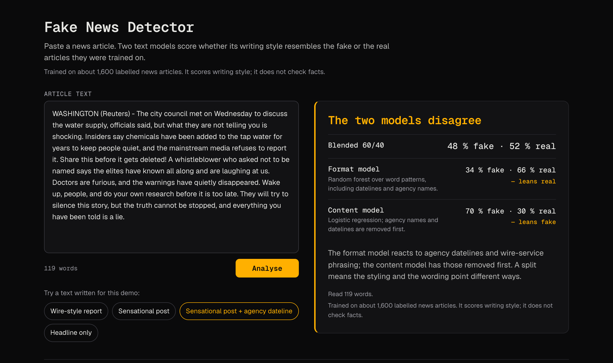

# Fake News Detector

A Flask service and web page that scores whether a pasted news article's **writing style**
resembles the fake or the real articles its two models were trained on. It does not check facts.



- **Format model** — a random forest (100 trees, depth 20, balanced class weights) over 15,000
  TF-IDF features of one- to three-word phrases, including datelines and agency names.
- **Content model** — a logistic regression over 12,000 TF-IDF features, reading the text after
  agency names and datelines (`WASHINGTON (Reuters) -` and similar) are removed.
- **Blend** — 60 % format, 40 % content. The page shows all three, and says when the models
  disagree.

Both models were trained on about 1,600 labelled news articles (Kaggle
`clmentbisaillon/fake-and-real-news-dataset`); that data is not in this repository.

## Run it

Python 3.12 or 3.13.

```bash
uv venv --python 3.12 .venv
uv pip install --python .venv/bin/python -r requirements.txt
.venv/bin/python app/app.py
```

Or, with the standard tools: `python3.12 -m venv .venv` then `.venv/bin/pip install -r requirements.txt`.

Open <http://127.0.0.1:8080>. The debugger is off; `FLASK_DEBUG=1` turns it on for UI work,
and `PORT=8090` moves the server. The same server starts with `.venv/bin/python main.py run`, or
behind gunicorn:

```bash
.venv/bin/gunicorn --bind 127.0.0.1:8080 --workers 2 --preload app.app:app
```

### Docker

```bash
docker build -t fake-news-detector .
docker run --rm -p 8080:8080 fake-news-detector
curl -fsS localhost:8080/health
```

The image runs gunicorn on port 8080 as a non-root user, carries only the served code and the four
served model files, and does not train anything.

## What the page does

Paste an article, or load one of four texts written for this demo. The result is one of:

| State | When | What it shows |
|---|---|---|
| A verdict | Both models read the text | The blended score and each model's score, as whole percents, with a headline from `Too close to call` to `Reads strongly like fake news` / `…real reporting` |
| **The two models disagree** | One model leans fake (≥ 55 %) and the other leans real (≤ 45 %) | Both scores, which way each leans, and why a split happens |
| **Too little to go on** | Every model scores the text within 3 points of what it gives an empty text | No score for the text — the models have read nothing that moves them |
| **Too few words the models know** | Less than half of the text is in each model's vocabulary | No score |
| **Links aren't opened** | The text is only a link | No score |

The rules behind the two refusals, and the texts that pin them, are in `DECISIONS.md` (D2, D3).
They refuse readings that sit on the models' default answer, not short text as such: most
one-line headlines are still scored, and most of those lean fake.

## API

`POST /api/predict` with `Content-Type: application/json` and `{"text": "…"}`:

```bash
curl -s -H 'Content-Type: application/json' --data @samples/wire_report.json \
  localhost:8080/api/predict | python3 -m json.tool
```

```json
{
  "prediction": "REAL",
  "confidence": 73.3,
  "confidence_level": "MEDIUM",
  "is_uncertain": false,
  "models_agree": true,
  "text": "City officials said on Monday that the regional transit authority …",
  "ensemble_probabilities": {"fake": 26.7, "real": 73.3},
  "model_breakdown": {
    "format_model": {"prediction": "REAL", "fake_prob": 31.75, "real_prob": 68.25},
    "content_model": {"prediction": "REAL", "fake_prob": 19.13, "real_prob": 80.87}
  },
  "input_check": {
    "status": "ok",
    "word_count": 150,
    "known_features": {"format_model": 69, "content_model": 120},
    "coverage": {"format_model": 0.89, "content_model": 0.73},
    "points_from_empty": {"format_model": 33.77, "content_model": 30.63}
  }
}
```

`input_check.status` is `ok`, `no_signal`, `no_known_words` or `url_only`; the API still scores
the first three unless nothing is left to read.

| Route | Returns |
|---|---|
| `POST /api/predict` | the response above |
| `POST /api/predict/simple` | `text`, `prediction`, `confidence`, `confidence_score`, `input_check` |
| `GET /health` | `status`, `models`, `sklearn_version`; 503 when the format model did not load |
| `GET /api/models` | each model's type, feature count, n-gram range, weight and empty-text score |

Errors are JSON with `error` and a `code`: `bad_json`, `text_missing`, `text_not_string`,
`text_empty` (400) · `json_required` (415) · `too_large` (413, over 256 KB of text) ·
`url_only`, `no_known_words` (422, when cleaning leaves nothing) · `model_unavailable` (503) ·
`internal_error` (500, with a `request_id`; details go to the server log only).

## Tests

```bash
.venv/bin/python -m unittest discover -s tests -t . -v
```

Standard library only. The suite checks, among other things:

- **Responses:** the API still answers exactly what the 2025 code answered (`tests/golden.json`).
- **Page:** every state is reached with real input and shows no decimal percents.
- **Demo texts:** each one lands in its state with room to spare.
- **Run modes:** the documented commands work from any directory.

Further checks:

- `scripts/capture_golden.py --check` re-derives `tests/golden.json` from commit `23207ce` (needs
  `requirements-dev.txt`, because that code imports pandas).
- `scripts/mutants.py` applies deliberate bugs and fails unless the tests catch each one.
- `scripts/docker_smoke.sh` builds the image, runs it, and compares its answers with the golden
  file.

## What is and isn't here

- **Served:** `app/app.py`, `utils/`, `templates/index.html`, `static/`, `samples/`, and the four
  model files named above.
- **Not wired in:**
  - `app/advanced_app.py`, `app/final_app.py` and `backend/` are earlier experiments.
  - `model/advanced/` and `model/robust/` hold their models.
  - `model/*_old.pkl` is the logistic regression the served forest replaced.
  - The notebooks and training scripts are also unused.
- **Training is switched off** (`main.py train` refuses): the data isn't here, and
  `model/train_model.py` would overwrite the served forest with the older model.
- **Accuracy:** the figures in `ENHANCEMENTS_SUMMARY.md` (format model 98.75 %, content model
  96.5 %) and this README's earlier "85–90 %" (for the older model) are **author-reported and can't
  be re-run without the dataset**. The test split came from the same collection as the training
  data. Any real use needs evaluation on the text it will actually see.
- **Style, not facts:** the format model learned what wire-service copy looks like. A
  `WASHINGTON (Reuters) -` prefix alone moved its score by 19–30 points in our tests; the content
  model doesn't see it.
- **Old requirements:** the 2025 pins are kept in `docs/pins-2025.txt` as a record; they don't
  install on current Python and can't load the committed models.

## Roadmap

- [ ] Explanation features: highlight the phrases that drove a score
- [ ] Re-evaluate both models on held-out text from a different source
- [ ] Remove or archive the unused apps and models

No license file has been added yet.
